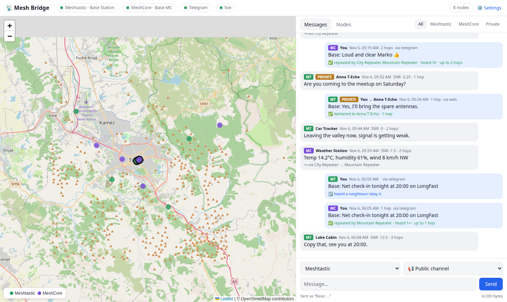
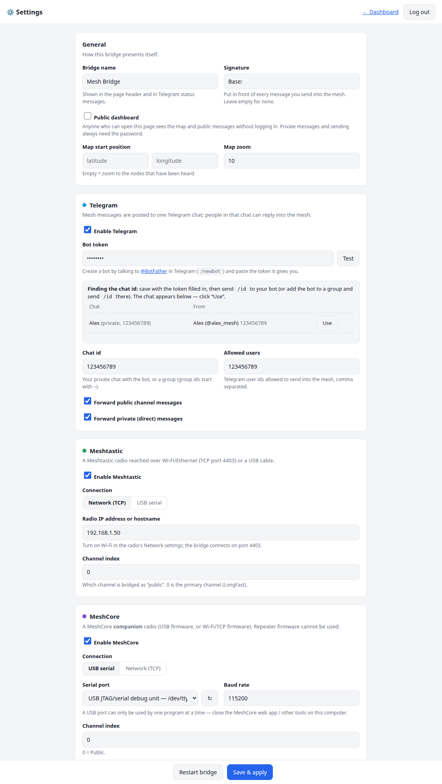
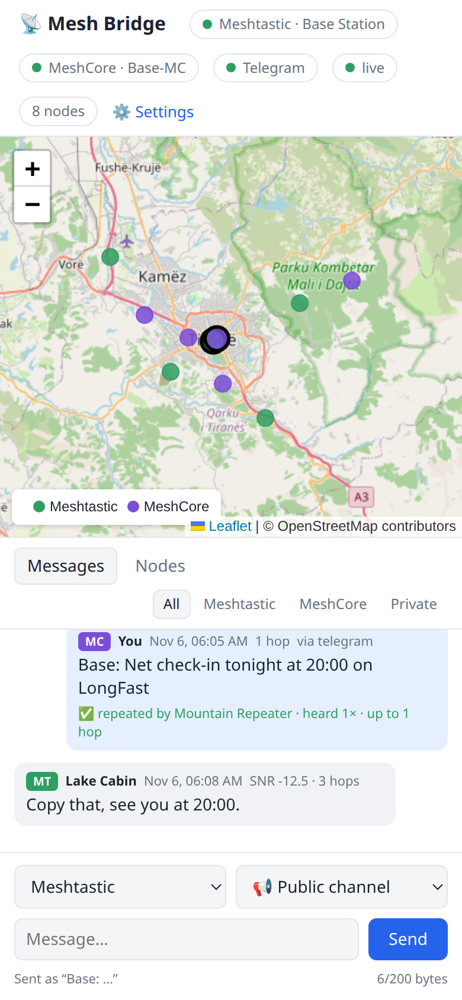

# 📡 Ura

*Every mesh, one world.*

**Ura** (Albanian for *bridge*) connects **Meshtastic** and **MeshCore** LoRa mesh networks to **Telegram** and a **web dashboard**.

- Messages on the mesh public channel and private (direct) messages show up in a Telegram chat.
- Reply in Telegram and the answer goes back into the mesh. A reply to a private message stays private.
- The web dashboard has a live map of every node heard, the message history, and a send box.
- Delivery tracking: ✅ delivered, ☑️ relayed by a neighbour, 🔁 repeated by MeshCore repeaters (with the route), ❌ failed.
  The Telegram status message updates live.
- **Everything is set up in the browser.** No config files to edit and nothing hard-coded.

Works with one radio or with both. Telegram is optional too: without it the bridge is a web dashboard and messenger for your mesh.



<table>
<tr>
<td width="62%"></td>
<td width="38%"></td>
</tr>
<tr>
<td align="center"><sub>All setup happens on the Settings page</sub></td>
<td align="center"><sub>Works on phones too</sub></td>
</tr>
</table>

<sub>Screenshots use demo data.</sub>

## What you need

| | |
|---|---|
| A computer that stays on | Linux PC, Raspberry Pi, mini PC or server. Python 3.10+ or Docker. |
| Meshtastic radio *(optional)* | Reached over **Wi-Fi/Ethernet** (TCP port 4403) or a **USB** cable. |
| MeshCore radio *(optional)* | Must run **companion** firmware: *USB Serial* or *Wi-Fi* (TCP). Repeater/room-server firmware won't work. |
| Telegram bot *(optional)* | Free. Create one with [@BotFather](https://t.me/BotFather). |

> A USB serial port can only be used by **one program at a time**. Close the MeshCore/Meshtastic web
> app, the CLI and any other tool that uses the radio, or the bridge can't connect ("Device or resource busy").

## Install

### Option A: Python (Linux / Raspberry Pi)

```bash
git clone https://github.com/ximi87/ura.git ~/ura
cd ~/ura
python3 -m venv venv
venv/bin/pip install -r requirements.txt
sudo usermod -aG dialout $USER     # access to USB radios; log out and back in once
venv/bin/python bridge.py
```

To start it automatically at boot, use the included systemd service:

```bash
mkdir -p ~/.config/systemd/user
cp contrib/ura.service ~/.config/systemd/user/
systemctl --user daemon-reload
systemctl --user enable --now ura
sudo loginctl enable-linger $USER          # keep running when you are logged out
journalctl --user -u ura -f        # logs
```

### Option B: Docker

```bash
git clone https://github.com/ximi87/ura.git && cd ura
docker compose up -d --build
docker compose logs -f
```

## First start

1. Open `http://<computer-ip>:8080/` in a browser.
2. You will be asked for a **setup code**. It is printed in the log at startup and saved in
   `data/setup-code.txt`. It makes sure that only the person who installed the bridge can claim it.
3. Choose an admin password. The **Settings** page opens next.

## Settings (all in the browser)

**Meshtastic:** tick *Enable*, then choose *Network* and type the radio's IP, or *USB* and pick the port
from the list. Channel 0 is the primary channel.

**MeshCore:** tick *Enable*, choose *USB serial* and pick the port, or *Network* for Wi-Fi companion firmware.
Channel 0 is *Public*.

**Telegram:**
1. In Telegram, talk to [@BotFather](https://t.me/BotFather), send `/newbot` and copy the token.
2. Paste it into *Bot token*, click **Test**, then **Save & apply**.
3. Send `/id` to your bot in a private chat, or add the bot to a group and send `/id` there.
4. The chat appears on the Settings page. Click **Use**, then **Save & apply**.

*Allowed users* limits who may send into the mesh. Leave it empty to let everyone in the chat send.

**General:** the bridge name, a signature put in front of every message you send (for example `Base: `),
the map start position, and **Public dashboard**. When Public dashboard is on, anyone can see the map
and the public messages. Private messages and sending always need the password.

**Save & apply** restarts the bridge in a few seconds with the new settings.

## Using it from Telegram

| | |
|---|---|
| Reply to a forwarded message | Answer goes back to the same network (privately, if the original was private) |
| `/mt text` | Send to the Meshtastic public channel |
| `/mc text` | Send to the MeshCore public channel |
| `/all text` | Send to both |
| `/status` | Radio connection status |
| `/id` | Show your user id and the chat id |

The message size limit is about 200 bytes on Meshtastic and 130 bytes on MeshCore. Longer text is cut.

## Environment variables

Only needed to change where things run. Everything else is set on the Settings page.

| Variable | Default | |
|---|---|---|
| `DATA_DIR` | `./data` | Holds `config.json` (settings and bot token) and `messages.db` (history) |
| `WEB_PORT` | `8080` | Web port |
| `WEB_HOST` | `0.0.0.0` | Bind address. Use `127.0.0.1` behind a reverse proxy |

## Security notes

- `data/config.json` contains your bot token. It is created with mode 600 and is excluded from git by `.gitignore`.
- The web UI uses plain HTTP. If you open it to the internet, put it behind a reverse proxy with
  HTTPS (Caddy, nginx, Traefik) or use a VPN such as WireGuard or Tailscale.
- Forgot the password? Stop the bridge, delete the `auth` → `password_hash` value in `data/config.json`
  and start it again. A new setup code is printed.

## Troubleshooting

| Problem | Fix |
|---|---|
| MeshCore "Device or resource busy" | Another program has the USB port open (often a browser tab with the MeshCore web app). |
| Port list is empty | Plug in the radio, then click ↻. On Linux, check that the user is in the `dialout` group. |
| Meshtastic over TCP doesn't connect | Wi-Fi must be on in the radio and port 4403 reachable. Only one TCP client at a time is reliable. |
| Bot says nothing | Check *chat id* and *Allowed users*. `/id` always answers, so you can confirm the bot is running. |
| In a group the bot ignores normal messages | Telegram privacy mode: use `/mt …` or reply to a bot message, or turn privacy off in @BotFather. |

## License

MIT, see [LICENSE](LICENSE).
